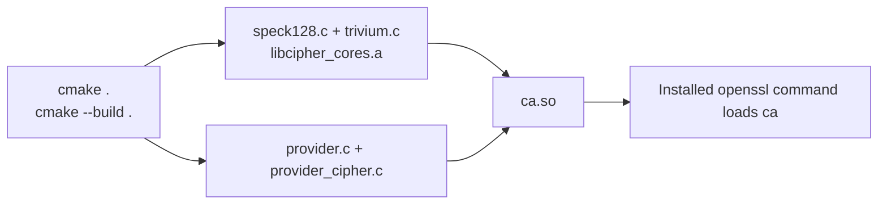
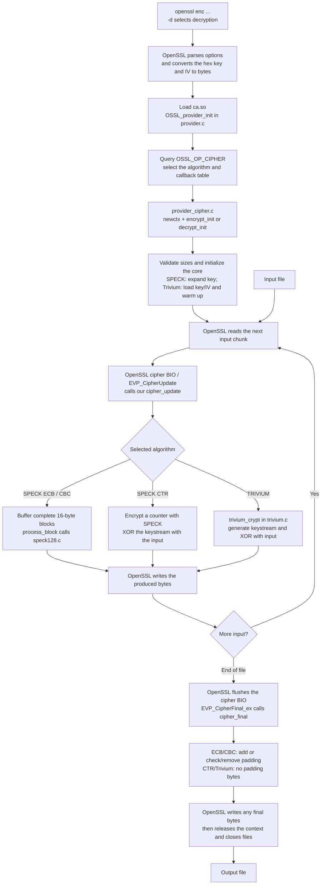

# How the project runs

The program you run is the installed `openssl` command. CMake builds our
loadable module, `ca.so`, from the project sources. OpenSSL loads that module
when you pass `-provider-path . -provider ca`. Our cipher files receive byte
buffers; OpenSSL handles command-line options and file access.

## Build and load



The static archive is linked into `ca.so`; it is not a second module that the
user has to load. The CMake file selects the sources and links OpenSSL's
`libcrypto`.

## Encrypting or decrypting a file

Example, with the same key and IV on both commands:

```sh
openssl enc -provider-path . -provider ca -TRIVIUM \
  -K 00010203040506070809 -iv 10111213141516171819 \
  -in input.txt -out ciphertext.bin

openssl enc -d -provider-path . -provider ca -TRIVIUM \
  -K 00010203040506070809 -iv 10111213141516171819 \
  -in ciphertext.bin -out recovered.bin
```



This is the successful path; a failed callback makes OpenSSL report an error.
The module is loaded once for the command, and the context keeps the state
between chunks. Initialization and Trivium's 1,152 warm-up steps do not happen
again for every chunk.

The CLI uses OpenSSL's cipher BIO, a buffer-processing wrapper around EVP.
Our module implements the provider callbacks behind EVP. The relevant
OpenSSL code is [apps/enc.c](https://github.com/openssl/openssl/blob/openssl-3.5.7/apps/enc.c);
the callback contract is documented in
[provider-cipher](https://docs.openssl.org/3.5/man7/provider-cipher/).

## What differs when decrypting?

| Algorithm | Encryption | Decryption |
| --- | --- | --- |
| SPECK ECB | Encrypt each block with SPECK. | Use SPECK's inverse rounds. |
| SPECK CBC | XOR plaintext with the previous ciphertext block, then encrypt. Use the IV for the first block. | Decrypt, then XOR with the previous ciphertext block, or IV for the first block. |
| SPECK CTR | Encrypt the counter and XOR with input. Increment the big-endian counter. | Perform the same keystream/XOR operation, starting from the same counter. |
| Trivium | Generate keystream from the key/IV and XOR with input. | Perform the same keystream/XOR operation, starting from the same key/IV state. |

With padding enabled, ECB/CBC encryption adds PKCS#7 padding at the end.
Decryption keeps the last block until finalization so its padding can be
checked and removed. With `-nopad`, their input must be a multiple of 16 bytes.

The `-a` option is handled by OpenSSL: encryption Base64-encodes the ciphertext;
decryption Base64-decodes the input before passing it to the cipher. See
[openssl enc](https://docs.openssl.org/3.5/man1/openssl-enc/).
Our provider never needs to interpret the file as text.

## Which source does what?

| File | Responsibility |
| --- | --- |
| `provider.c` | Exports `OSSL_provider_init`, metadata and the four cipher registrations. |
| `provider_cipher.c` | Implements the OpenSSL callback interface, contexts, modes, buffering, padding and parameter checks. |
| `speck128.c` | Implements the block cipher: key expansion, block encryption and block decryption. |
| `trivium.c` | Implements stream initialization, one-bit clock steps, byte generation and XOR. |
| `CMakeLists.txt` | Builds and links the module. |

For `openssl speed`, OpenSSL generates benchmark buffers instead of reading an
input file, then exercises the same EVP/provider path. Loading `default`
alongside `ca` supplies OpenSSL's random-key generation.

## Implementation references

SPECK follows the designers' [Implementation Guide](https://nsacyber.github.io/simon-speck/implementations/ImplementationGuide1.1.pdf),
sections 1, 6 and 16. The local `speck_round` corresponds to `ER64`,
`speck_inverse_round` to `DR64`, and `speck128_init` to
`Speck128128KeySchedule`.

Trivium's clock-step layout is adapted from
[Wu Han's C implementation](https://github.com/wuhanstudio/trivium/blob/b8bc30f412c4c9cf3d8ea0c7ed1755be577ebdd1/trivium-c/trivium.c).
The original stores packed bits and uses helper functions to access them.
Our adaptation uses one array element per bit, a descending shift loop and
the project's existing key/IV serialization. The MIT notice is retained in
`THIRD_PARTY_NOTICES.md`. Detailed attribution and validation belong in `REPORT_NOTES.md`.
